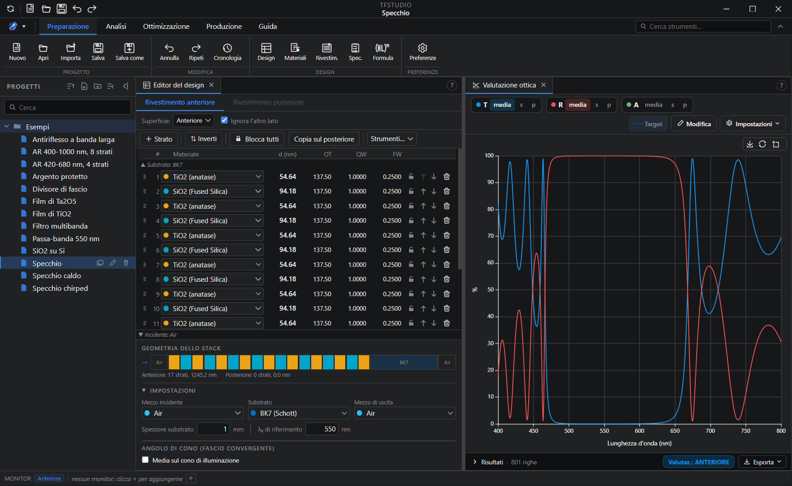
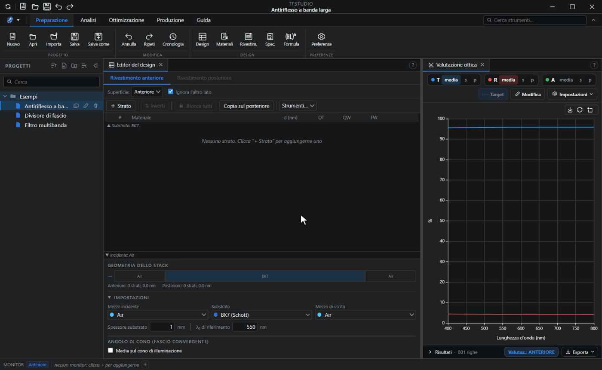
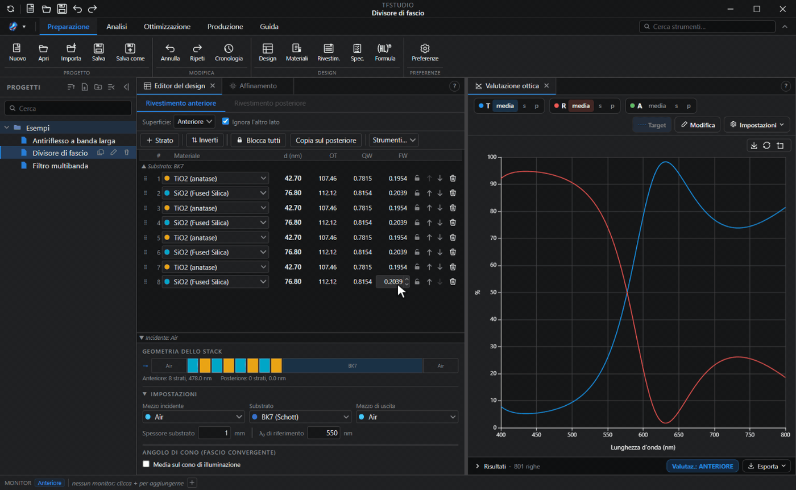
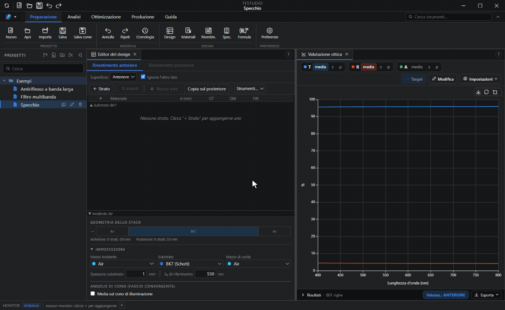
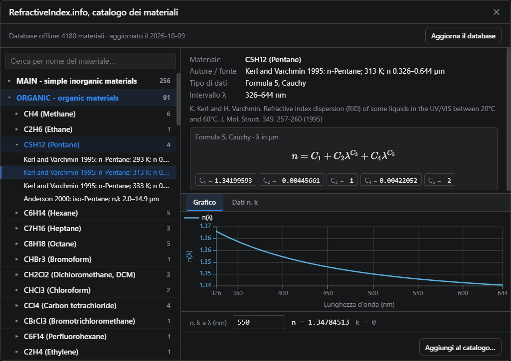

<div align="center">

<picture>
  <source media="(prefers-color-scheme: dark)"
          srcset="https://raw.githubusercontent.com/aai2k/TFStudio/main/assets/banner-on-dark.png">
  
</picture>

**Un ambiente open source per la progettazione, l'analisi e l'ottimizzazione di rivestimenti ottici a film sottile.**

[](./LICENSE)

[](../../releases)

[](https://qlty.sh/gh/aai2k/projects/TFStudio)
[](https://doi.org/10.5281/zenodo.21196149)

**[Sito web](https://tfstudio.xyz)** · **[Tutorial](https://tfstudio.xyz/blog)** · **[Demo online](https://tfstudio.xyz/demo/)** · **[Documentazione](https://docs.tfstudio.xyz)** · **[Download](../../releases)** · **[Roadmap](./ROADMAP.md)**

[English](./README.md) · [简体中文](./README.zh-CN.md) · **Italiano**



</div>

## Che cos'è TFStudio?

TFStudio è un'applicazione desktop per progettare e analizzare **rivestimenti ottici a film sottile**: trattamenti antiriflesso, specchi, divisori di fascio, filtri passa-banda e filtri a fronte, e altro ancora. Offre un motore ottico in doppia precisione, algoritmi di affinamento e di sintesi e un insieme di strumenti di analisi, in un'interfaccia a più finestre agganciabili.

> ⚠️ **Stato:** TFStudio è un software sviluppato in modo indipendente. Verifica sempre i design critici con i tuoi calcoli e le tue misure prima di destinarli a un ciclo di deposizione di produzione.

## Funzionalità principali

**Progettazione e valutazione**
- Metodo delle matrici di trasferimento (TMM) per mezzi **assorbenti e dispersivi** a **incidenza obliqua**, sia in polarizzazione **s** sia **p**
- Modellazione del sistema completo: rivestimento anteriore, substrato (con assorbimento) e rivestimento posteriore, comprese le riflessioni multiple incoerenti nel substrato
- Progettazione del rivestimento anteriore, di quello posteriore o di entrambi insieme, con il posteriore che può restare la copia speculare dell'anteriore; ogni finestra valuta un solo lato oppure il pezzo intero
- Media su un cono di illuminazione convergente o divergente, con intensità uniforme, lambertiana o tabulata
- Spettri di riflettanza / trasmittanza / assorbimento in percentuale, decibel o densità ottica, colore, valori integrali
- Editor del design con rappresentazioni simultanee dello spessore: fisico, ottico, in quarti d'onda e in onde intere
- **Formula dello stack:** costruisce un intero stack da una formula come `Air | (HL)^4 H | Glass`
- **Specifica:** i requisiti del design come verifiche conforme / non conforme in tempo reale, trasformati in righe della funzione di merito con un solo pulsante e usati come criterio di conformità nell'analisi Monte Carlo della resa
- **Libreria dei rivestimenti:** rivestimenti conservati come stack riutilizzabili con il loro substrato, mezzo incidente, banda e angolo, con i design di partenza predefiniti accanto ai tuoi, da applicare a uno dei due lati di un design

**Ottimizzazione e sintesi**
- Metodi di affinamento: QP sequenziale (SQP) con limiti, minimi quadrati smorzati (Levenberg-Marquardt), gradiente coniugato, Newton, Newton-CG, DLS multi-start, evoluzione differenziale e ricottura simulata, oppure tutti a turno, tenendo il migliore; i metodi a gradiente usano uno **jacobiano analitico**
- Ottimizzazione **Needle** e sintesi per **evoluzione graduale** (inserimento automatico degli strati partendo da zero)
- Ottimizzazione strutturale sul numero stesso degli strati
- **Procedura guidata per la progettazione di filtri:** prototipi Fabry-Perot a più cavità, passa-banda e notch (DWDM, LWDM), costruiti in pochi passi guidati, a incidenza normale o obliqua
- Funzione di merito flessibile: target spettrali, rampe, medie sulla banda, operandi del caso peggiore, vincoli di spessore
- Fit su uno spettro misurato importato, come una riga in più nella funzione di merito
- **Variatore:** cursori sullo spessore di ogni strato e sul substrato, seguiti da ogni finestra aperta, e su n e k di ogni materiale
- **Pulizia del design:** unisce gli strati adiacenti dello stesso materiale e rimuove quelli molto sottili, poi, se richiesto, esegue di nuovo l'affinamento
- Esecuzione multi-thread con un pool di Web Worker; i kernel di calcolo più pesanti sono accelerati con **WebAssembly**





**Finestre di analisi**
- Valutazione ottica, mappe lunghezza d'onda / angolo, diagrammi di ammettenza, profili del campo elettrico, ritardo di gruppo / GDD, dispersione in un materiale massivo, parametri ellissometrici, valutazione del colore, profilo dell'indice di rifrazione, diagramma degli spessori degli strati
- **Motore dei grafici:** grafici personalizzati a più curve, oppure una grandezza qualsiasi mappata su due variabili in scansione come mappa di calore o superficie 3D
- **Analisi dell'impulso:** un impulso gaussiano, sech² o supergaussiano, oppure uno spettro misurato con la sua fase, riflesso dal rivestimento o trasmesso attraverso di esso per un numero qualsiasi di rimbalzi, confrontato con l'impulso limitato in trasformata dello stesso spettro, con durata in uscita, picco, ritardo e GDD residuo
- Analisi di tolleranza e di produzione: analisi degli errori Monte Carlo, sensibilità degli strati, disomogeneità, rugosità / scattering, deviazioni sistematiche
- **Stress:** lo stress di ogni film con la sua componente termica, la curvatura che lascia nel substrato e quanto lo stack è vicino alla formazione di cricche o alla delaminazione, a partire dalle costanti meccaniche memorizzate in ciascun materiale; un operando `STR` della funzione di merito bilancia la forza dei film per ottenere un pezzo piano



**Materiali**
- Libreria predefinita: vetri Sellmeier trascritti dalle pubblicazioni originali e dalla scheda tecnica Schott, e film e metalli tabulati generati dal database [refractiveindex.info](https://refractiveindex.info) (CC0)
- Dispersione: le formule di Zemax, le formule generali di Sellmeier e di Cauchy, le forme Schott, Hartmann e Drude di OptiLayer, le formule di refractiveindex.info e n,k tabulati; indice complesso con convenzioni esplicite
- Importazione di cataloghi di materiali da file Zemax AGF, TFCalc, Essential Macleod e OptiLayer, e un catalogo dei materiali RefractiveIndex.info integrato nell'app
- Include il catalogo dei vetri Schott, i cataloghi dei materiali per rivestimenti e substrati e una copia offline del database refractiveindex.info, così il catalogo RefractiveIndex.info funziona anche senza connessione



**Dati misurati**
- Importazione di spettri R / T / A misurati e dei Ψ e Δ ellissometrici, sovrapposti alle curve calcolate
- Legge file di testo delimitato in qualsiasi formato comune (tra cui i file esportati da PerkinElmer, Shimadzu, Cary e Filmetrics), JCAMP-DX e i file esportati dagli ellissometri Woollam e Accurion
- **Editor di curve:** digitare, incollare o correggere i punti di una curva prima di applicarla
- **Caratterizzazione n,k:** ricava indice, coefficiente di estinzione e spessore di un film da una trasmittanza e una riflettanza misurate, oppure da una coppia Ψ e Δ, e salva il risultato come materiale
- Fit di un design su Ψ e Δ misurati: la curva diventa target della funzione di merito per l'affinamento
- Esportazione delle curve misurate o calcolate in nm, µm o numero d'onda, come frazione o come percentuale

**Produzione**
- Simulazione della deposizione e del monitoraggio (monitoraggio ottico a banda larga e monocromatico)
- Foglio di monitoraggio: lunghezza d'onda di monitoraggio per ogni strato e assegnazione ai vetrini testimone, con la segnalazione, prima del ciclo, degli strati che non si possono terminare con precisione sufficiente
- Esporta processo
- Scambio di rivestimenti con i software di progettazione ottica, in entrambe le direzioni: `COATING.DAT` di Zemax OpticStudio e MULTILAYER di CODE V (`.seq` / `.mul`)
- Importazione di design da TFCalc (`.tfd`), Essential Macleod (`.dds`) e OptiLayer (`.dsg`), con i materiali abbinati ai tuoi cataloghi
- **Report:** un documento costruito a blocchi su uno o più design, salvato come PDF o come un unico file HTML

**Piattaforma**
- Applicazione desktop multipiattaforma (Electron + React, JavaScript puro)
- Barra multifunzione a schede con una casella di ricerca che trova qualsiasi strumento per nome
- Le finestre si agganciano tra loro, oppure il layout si stacca su un secondo monitor
- Guida e documentazione integrate, interfaccia in inglese, russo, cinese e italiano

## Base scientifica

Metodi e relative fonti:

- **Metodo delle matrici di trasferimento:** H. A. Macleod, *Thin-Film Optical Filters*, 5th ed.
- **Sintesi needle numerica:** Sullivan & Dobrowolski, *Appl. Opt.* **35**, 5484 (1996); Tikhonravov et al., *Appl. Opt.* **35**, 5493 (1996)
- **Evoluzione graduale:** Tikhonravov et al. (2007)
- **Dispersione e propagazione degli impulsi:** Birge & Kärtner, *Appl. Opt.* **45**, 1478 (2006)
- **Stress dei film, curvatura del substrato e criteri di cedimento:** Klokholm, *IBM J. Res. Dev.* **31**, 585 (1987); Suhir, *J. Appl. Phys.* **88**, 2363 (2000); Klein, *J. Appl. Phys.* **88**, 5487 (2000) e *Opt. Eng.* **40**, 1115 (2001)

Tutti i calcoli sono in doppia precisione.

Il motore a matrici di trasferimento è pubblicato a parte come **[tmmcore](https://github.com/aai2k/tmmcore)**. La sua [pagina di confronto](https://aai2k.github.io/tmmcore/comparison/) ne misura accuratezza e velocità rispetto a `tmm` (Byrnes), `tmm_fast`, `tmmax` e `tmm_faster`, e descrive il metodo e i suoi limiti. I risultati di riferimento sono inclusi in quel repository, quindi `npm run compare` lì riproduce la tabella di accuratezza con il solo Node e senza Python.

## Installazione

### Download (consigliato)

Scarica l'ultima versione per la tua piattaforma dalla pagina [**Releases**](../../releases).

**Windows:** `TFStudio.Setup.<ver>.exe` si installa nel modo consueto; `TFStudio-<ver>-Portable.exe` è un unico eseguibile che non richiede installazione, pensato per i PC degli impianti di deposizione con permessi limitati. Vengono pubblicate anche versioni separate per Windows 7/8.1.

**Linux:** su Debian e Ubuntu il pacchetto consigliato è `TFStudio-<ver>-amd64.deb`:

```bash
sudo apt install ./TFStudio-*-amd64.deb
tfstudio
```

L'installazione come root è ciò che permette di tenere attiva la sandbox di Chromium. Il `.deb` è l'unico pacchetto Linux che la mantiene attiva, ed è anche l'unico che aggiunge TFStudio al menu delle applicazioni e fa aprire i design `.tfs` con TFStudio dal gestore di file. L'AppImage non passa da alcuna installazione, quindi non registra il tipo di file.

`TFStudio-<ver>-x86_64.AppImage` è l'alternativa portatile:

```bash
chmod +x TFStudio-*-x86_64.AppImage
./TFStudio-*-x86_64.AppImage
```

L'AppImage non richiede `libfuse2`. Se non riesce proprio a montarsi da sola, come in un container senza FUSE, avviala con `--appimage-extract-and-run`.

Vuoi provarlo prima? Apri la **[demo web online](https://tfstudio.xyz/demo/)**: design di esempio e spettri in tempo reale nel browser, senza installare nulla.

### Compilazione dai sorgenti

Richiede [Node.js](https://nodejs.org) 22.12+ e git.

```bash
git clone https://github.com/aai2k/TFStudio.git
cd TFStudio
npm install
npm start          # avvia l'applicazione
```

Il kernel WebAssembly a matrici di trasferimento arriva già compilato con la dipendenza `tmmcore`, quindi non serve la toolchain Emscripten e le compilazioni dai sorgenti ottengono le stesse prestazioni dei binari pubblicati.

`npm run build` scarica automaticamente il sottomodulo con il database refractiveindex.info e installa le dipendenze del sito della documentazione. Il database è grande; per scaricarlo subito invece che alla prima compilazione, clona con `--recursive`.

Altri script utili:

```bash
npm test              # esegue la suite di test
npm run docs:dev      # anteprima del sito della documentazione (alla prima esecuzione installa le dipendenze)
npm run build         # crea un pacchetto distribuibile (electron-builder)
```

### Creazione dei pacchetti di rilascio

`build-release.ps1` prepara tutto ciò che serve a un clone appena scaricato e crea gli installer in un solo passaggio. Chiede quali target opzionali includere; passa i flag per rispondere in anticipo.

```powershell
npm run dist                  # installer Windows 10/11 + versione portatile
npm run dist -- -Win7         # ...e le versioni per Windows 7/8.1
npm run dist -- -Linux        # solo Linux: .deb + AppImage
```

I pacchetti Linux sono prodotti da `build-release-linux.sh`, che lo script di rilascio esegue tramite WSL; funziona anche direttamente su qualsiasi host Linux. Richiede una distribuzione con Node.js 22.12+ e `rsync`, e compila nel filesystem Linux invece che sul posto, così un checkout Windows conserva il proprio `node_modules` di Windows. La compilazione WSL avviata da Windows salta la verifica dell'interfaccia grafica. Una compilazione diretta su Linux avvia l'applicazione non impacchettata sotto Xvfb come smoke test, oppure lo salta con un messaggio se Xvfb non è installato.

Nota: lo smoke test gira sotto Xvfb, quindi prova solo il percorso X11. Una regressione che compare soltanto sotto Wayland nativo, come una finestra che non viene mai mostrata, lo supera.

Le build per macOS richiedono un host macOS e al momento non vengono pubblicate.

La documentazione per l'utente è ospitata su **[docs.tfstudio.xyz](https://docs.tfstudio.xyz)**, è integrata nell'app (menu Guida) e il suo sorgente si trova in [`docs-site/`](./docs-site).

## Come citare TFStudio

Se TFStudio ha contribuito al tuo lavoro, ti chiediamo di citarlo. I metadati di citazione sono in [`CITATION.cff`](./CITATION.cff); GitHub ne ricava un pulsante "Cite this repository".

## Contribuire

Issue e pull request sono benvenute. Poiché TFStudio è uno strumento scientifico, i contributi al motore ottico devono rispettare uno standard di correttezza fisica (cita le fonti, valida rispetto a un riferimento, aggiungi un test). Leggi [**CONTRIBUTING.md**](./CONTRIBUTING.md) prima di aprire una pull request.

Contribuendo, accetti che i tuoi contributi vengano rilasciati con la licenza MIT del progetto.

## Licenza

[MIT](./LICENSE) © 2026 Andrey Achapovsky

## Autore

**Andrey Achapovsky:** [ORCID 0009-0005-1497-6279](https://orcid.org/0009-0005-1497-6279)

## Ringraziamenti

- Dati dei materiali ricavati dal database [refractiveindex.info](https://refractiveindex.info) (CC0, pubblico dominio).
- Sviluppato con [Electron](https://www.electronjs.org/), [React](https://react.dev/), [Apache ECharts](https://echarts.apache.org/) e [KaTeX](https://katex.org/).
